

  

## 🛡️ Security contributions

Vulnerabilities and bugs I've reported to open-source projects. Disclosed findings link to their advisory or issue; the rest link to the project.

<!-- BEGIN:contributions (generated by scripts/generate.py, edits inside are overwritten) -->

<picture><source media="(prefers-color-scheme: dark)" srcset="assets/stats-dark.svg"></picture>

### Disclosed

<a href="https://github.com/SinTan1729/chhoto-url/security/advisories/GHSA-xq5g-cjm5-w3q2"><picture><source media="(prefers-color-scheme: dark)" srcset="assets/cards/sintan1729-chhoto-url-dark.svg">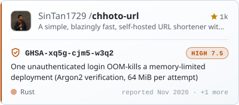</picture></a>
<a href="https://github.com/excon/excon/security/advisories/GHSA-h8qf-v835-mx7g"><picture><source media="(prefers-color-scheme: dark)" srcset="assets/cards/excon-excon-dark.svg">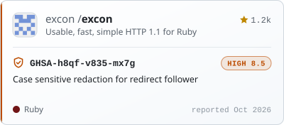</picture></a>
<a href="https://github.com/nuxt/nuxt/security/advisories/GHSA-9v7c-q64q-vv33"><picture><source media="(prefers-color-scheme: dark)" srcset="assets/cards/nuxt-nuxt-dark.svg">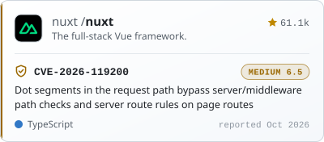</picture></a>
<a href="https://github.com/louislam/uptime-kuma/issues/8165"><picture><source media="(prefers-color-scheme: dark)" srcset="assets/cards/louislam-uptime-kuma-dark.svg">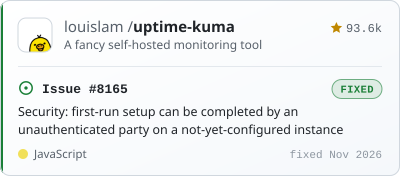</picture></a>
<a href="https://github.com/pnpm/pnpm/issues/17205"><picture><source media="(prefers-color-scheme: dark)" srcset="assets/cards/pnpm-pnpm-dark.svg">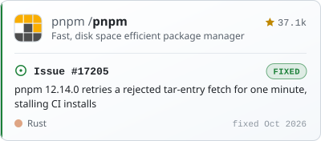</picture></a>
<a href="https://github.com/honojs/hono/issues/5592"><picture><source media="(prefers-color-scheme: dark)" srcset="assets/cards/honojs-hono-dark.svg">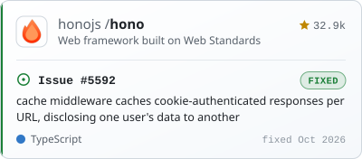</picture></a>

### Reported privately

Sent through GitHub's private vulnerability reporting. Details stay private until each advisory is published, then the card switches to the full write-up.

<a href="https://github.com/morluto/rea"><picture><source media="(prefers-color-scheme: dark)" srcset="assets/cards/morluto-rea-dark.svg">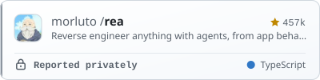</picture></a>
<a href="https://github.com/n8n-io/n8n"><picture><source media="(prefers-color-scheme: dark)" srcset="assets/cards/n8n-io-n8n-dark.svg"></picture></a>
<a href="https://github.com/ollama/ollama"><picture><source media="(prefers-color-scheme: dark)" srcset="assets/cards/ollama-ollama-dark.svg"></picture></a>
<a href="https://github.com/langgenius/dify"><picture><source media="(prefers-color-scheme: dark)" srcset="assets/cards/langgenius-dify-dark.svg">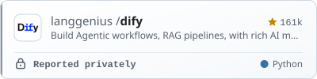</picture></a>
<a href="https://github.com/open-webui/open-webui"><picture><source media="(prefers-color-scheme: dark)" srcset="assets/cards/open-webui-open-webui-dark.svg">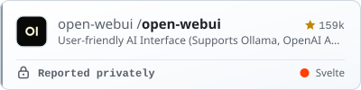</picture></a>
<a href="https://github.com/immich-app/immich"><picture><source media="(prefers-color-scheme: dark)" srcset="assets/cards/immich-app-immich-dark.svg">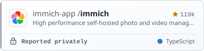</picture></a>
<a href="https://github.com/thedotmack/claude-mem"><picture><source media="(prefers-color-scheme: dark)" srcset="assets/cards/thedotmack-claude-mem-dark.svg">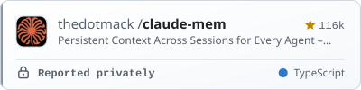</picture></a>
<a href="https://github.com/supabase/supabase"><picture><source media="(prefers-color-scheme: dark)" srcset="assets/cards/supabase-supabase-dark.svg"></picture></a>
<a href="https://github.com/Stirling-Tools/Stirling-PDF"><picture><source media="(prefers-color-scheme: dark)" srcset="assets/cards/stirling-tools-stirling-pdf-dark.svg">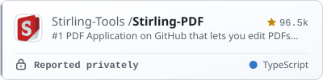</picture></a>
<a href="https://github.com/home-assistant/core"><picture><source media="(prefers-color-scheme: dark)" srcset="assets/cards/home-assistant-core-dark.svg"></picture></a>
<a href="https://github.com/python/cpython"><picture><source media="(prefers-color-scheme: dark)" srcset="assets/cards/python-cpython-dark.svg">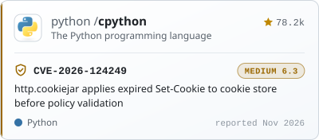</picture></a>
<a href="https://github.com/cline/cline"><picture><source media="(prefers-color-scheme: dark)" srcset="assets/cards/cline-cline-dark.svg"></picture></a>
<a href="https://github.com/calcom/cal.diy"><picture><source media="(prefers-color-scheme: dark)" srcset="assets/cards/calcom-cal-diy-dark.svg">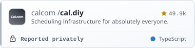</picture></a>
<a href="https://github.com/php/php-src"><picture><source media="(prefers-color-scheme: dark)" srcset="assets/cards/php-php-src-dark.svg">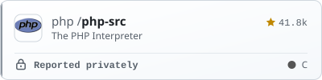</picture></a>
<a href="https://github.com/fosrl/pangolin"><picture><source media="(prefers-color-scheme: dark)" srcset="assets/cards/fosrl-pangolin-dark.svg">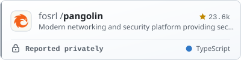</picture></a>
<a href="https://github.com/ActivityWatch/activitywatch"><picture><source media="(prefers-color-scheme: dark)" srcset="assets/cards/activitywatch-activitywatch-dark.svg">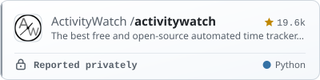</picture></a>
<a href="https://github.com/elysiajs/elysia"><picture><source media="(prefers-color-scheme: dark)" srcset="assets/cards/elysiajs-elysia-dark.svg">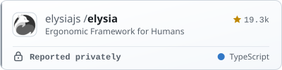</picture></a>
<a href="https://github.com/tobychui/zoraxy"><picture><source media="(prefers-color-scheme: dark)" srcset="assets/cards/tobychui-zoraxy-dark.svg">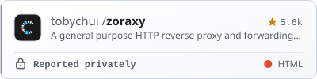</picture></a>
<a href="https://github.com/pomerium/pomerium"><picture><source media="(prefers-color-scheme: dark)" srcset="assets/cards/pomerium-pomerium-dark.svg">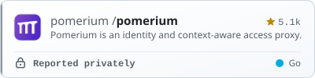</picture></a>
<a href="https://github.com/abhinavxd/libredesk"><picture><source media="(prefers-color-scheme: dark)" srcset="assets/cards/abhinavxd-libredesk-dark.svg">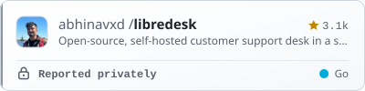</picture></a>
<a href="https://github.com/donetick/donetick"><picture><source media="(prefers-color-scheme: dark)" srcset="assets/cards/donetick-donetick-dark.svg"></picture></a>
<a href="https://github.com/delvedor/find-my-way"><picture><source media="(prefers-color-scheme: dark)" srcset="assets/cards/delvedor-find-my-way-dark.svg"></picture></a>
<a href="https://github.com/SuiteCRM/SuiteCRM-Core"><picture><source media="(prefers-color-scheme: dark)" srcset="assets/cards/suitecrm-suitecrm-core-dark.svg">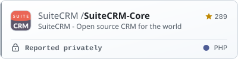</picture></a>

<b>📋 Disclosure log</b> (7 entries)

| Date | Project | Finding | Status |
| :-- | :-- | :-- | :-- |
| 2026‑11‑12 | [louislam/uptime-kuma](https://github.com/louislam/uptime-kuma) | [Issue&nbsp;#8165](https://github.com/louislam/uptime-kuma/issues/8165) Security: first-run setup can be completed by an unauthenticated party on a not-yet-configured instance | ✅&nbsp;Fixed |
| 2026‑11‑11 | [SinTan1729/chhoto-url](https://github.com/SinTan1729/chhoto-url) | [GHSA-xq5g-cjm5-w3q2](https://github.com/SinTan1729/chhoto-url/security/advisories/GHSA-xq5g-cjm5-w3q2) One unauthenticated login OOM-kills a memory-limited deployment (Argon2 verification, 64 MiB per attempt) | 🟠&nbsp;High |
| 2026‑11‑11 | [SinTan1729/chhoto-url](https://github.com/SinTan1729/chhoto-url) | [GHSA-pv8r-78qm-87c2](https://github.com/SinTan1729/chhoto-url/security/advisories/GHSA-pv8r-78qm-87c2) Argon2 password hash is silently discarded when it fails to parse — authentication disabled (fail-open) | 🟠&nbsp;High |
| 2026‑10‑30 | [honojs/hono](https://github.com/honojs/hono) | [Issue&nbsp;#5592](https://github.com/honojs/hono/issues/5592) cache middleware caches cookie-authenticated responses per URL, disclosing one user's data to another | ✅&nbsp;Fixed |
| 2026‑10‑28 | [excon/excon](https://github.com/excon/excon) | [GHSA-h8qf-v835-mx7g](https://github.com/excon/excon/security/advisories/GHSA-h8qf-v835-mx7g) Case sensitive redaction for redirect follower | 🟠&nbsp;High |
| 2026‑10‑27 | [nuxt/nuxt](https://github.com/nuxt/nuxt) | [CVE-2026-119200 · GHSA-9v7c-q64q-vv33](https://github.com/nuxt/nuxt/security/advisories/GHSA-9v7c-q64q-vv33) Dot segments in the request path bypass server/middleware path checks and server route rules on page routes | 🟡&nbsp;Medium |
| 2026‑10‑21 | [pnpm/pnpm](https://github.com/pnpm/pnpm) | [Issue&nbsp;#17205](https://github.com/pnpm/pnpm/issues/17205) pnpm 12.14.0 retries a rejected tar-entry fetch for one minute, stalling CI installs | ✅&nbsp;Fixed |

<!-- END:contributions -->

## 📈 Activity

  <picture>
    <source media="(prefers-color-scheme: dark)" srcset="https://raw.githubusercontent.com/vinzabe/vinzabe/output/snake-dark.svg">
    
  </picture>

Cards are built from the GitHub API by <a href="scripts/generate.py">scripts/generate.py</a> and refreshed every 6 hours by GitHub Actions.

